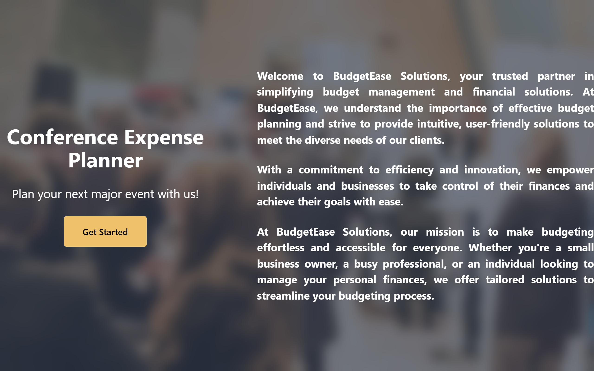
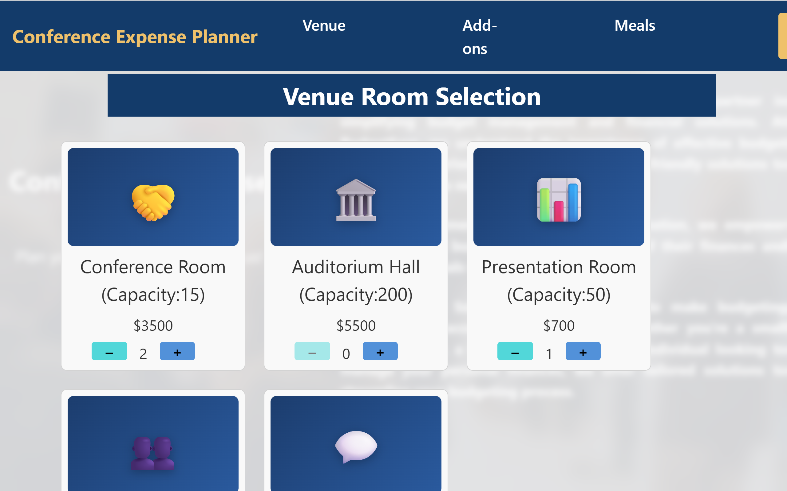

# Conference Expense Planner

A React + Redux Toolkit app for planning a conference event. Choose venue rooms, audio-visual equipment and meals, and see an itemised cost breakdown update in real time.

**Tech Stack:** React 18 · Redux Toolkit · React Redux · Vite

---

## Screenshots

<p align="center">
  
  
</p>

## Features

- **Venue selection**: pick from rooms ranging from small meeting rooms (5 people) to an auditorium hall (200 people)
- **Add-ons**: add audio-visual equipment (projectors, speakers, microphones, whiteboards, signage)
- **Meal planning**: choose meals per attendee, with cost based on the number of people
- **Live cost summary**: an itemised total across all categories, recalculated as you change selections

## State Management

Each category has its own Redux slice, combined in a single store:

```
src/
├── store.js          # configureStore with all slices
├── venueSlice.js     # Venue rooms & quantities
├── avSlice.js        # Audio-visual add-ons
├── mealsSlice.js     # Meal selections
├── ConferenceEvent.jsx
├── TotalCost.jsx     # Itemised cost breakdown
└── AboutUs.jsx
```

## Running Locally

```bash
npm install
npm run dev
```

---

Built as part of the IBM Front-End Development course on Coursera.
